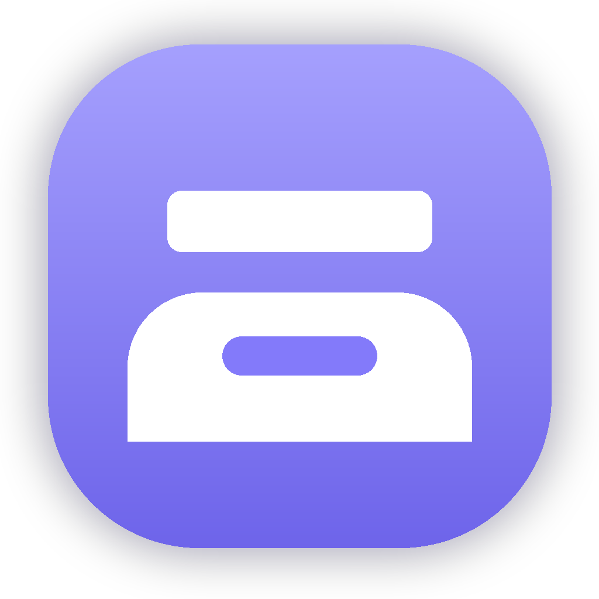
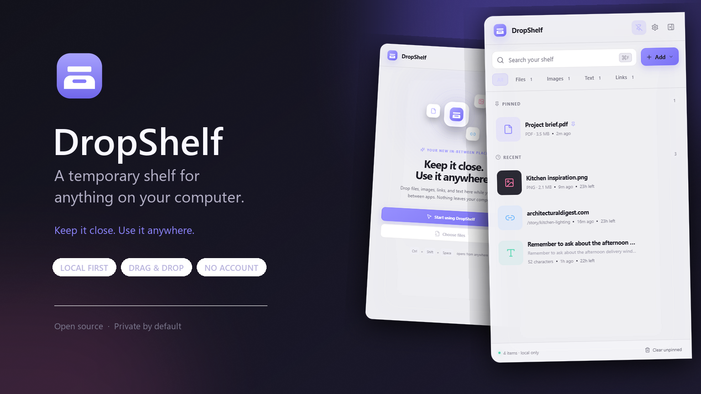
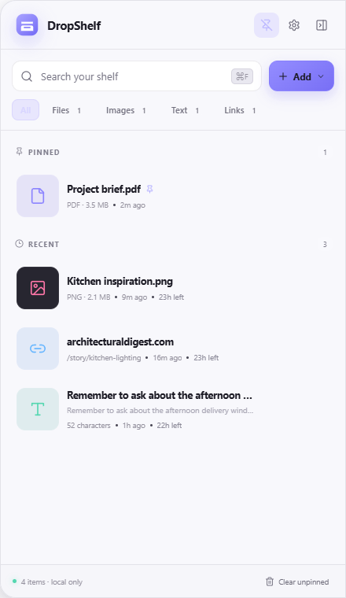
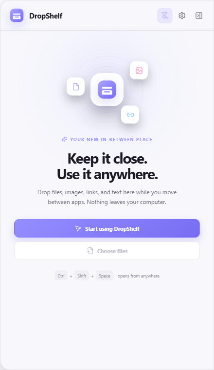
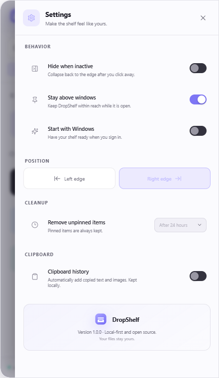

<div align="center">
  
  <h1>DropShelf</h1>
  <p><strong>A beautiful temporary shelf for anything on your computer.</strong></p>
  <p>Keep files, images, links, and text close while you move between apps.</p>

  [](https://github.com/noamsrv-cmd/dropshelf/actions/workflows/ci.yml)
  [](https://github.com/noamsrv-cmd/dropshelf/releases/latest)
  [](LICENSE)
  [](#privacy-by-design)
</div>

<br />



<div align="center">
  <a href="https://github.com/noamsrv-cmd/dropshelf/releases/latest/download/DropShelf-Windows-1.0.0-x64.exe"><strong>Download DropShelf for Windows</strong></a>
  &nbsp;·&nbsp;
  <a href="https://github.com/noamsrv-cmd/dropshelf/releases/latest/download/DropShelf-Portable-1.0.0-x64.exe">Portable version</a>
</div>

DropShelf lives quietly at the edge of your screen. Drag something in, switch apps, then drag it back out exactly where you need it. It is the missing space between your desktop, browser, messages, email, and file explorer.

## Why DropShelf

Moving something between apps should not require rearranging windows, covering the desktop with temporary files, or repeatedly searching through folders. DropShelf gives those in-between items a deliberate home.

| | |
|---|---|
| **Drop almost anything** | Files, folders, images, links, and plain text all live together. |
| **Use it from anywhere** | A screen-edge handle, system tray icon, and global shortcut keep it one gesture away. |
| **Drag it back out** | Files use native operating-system drag and drop. Text and links work with standard drag targets. |
| **Find things instantly** | Search, type filters, pinning, and clear metadata keep a busy shelf manageable. |
| **Clean without anxiety** | Unpinned items can expire automatically. Removing an item never deletes the original file. |
| **Private by default** | No account, analytics, cloud service, or network connection is required. |

## See it in action

<table>
  <tr>
    <td width="50%"></td>
    <td width="50%"></td>
  </tr>
  <tr>
    <td align="center"><sub>Everything you need, one drag away</sub></td>
    <td align="center"><sub>A calm first-run experience</sub></td>
  </tr>
</table>

<p align="center">
  
</p>

## Install

### Windows

Download the one-click Windows installer from the [latest release](https://github.com/noamsrv-cmd/dropshelf/releases/latest), or use the direct download below:

[**Download `DropShelf-Windows-1.0.0-x64.exe`**](https://github.com/noamsrv-cmd/dropshelf/releases/latest/download/DropShelf-Windows-1.0.0-x64.exe)

Double-click the downloaded file. DropShelf installs for the current Windows account, creates shortcuts, starts automatically when installation finishes, and does not require administrator access.

Because the first public build is not yet code-signed, Windows SmartScreen may show an **Unknown publisher** message. If the file came from this repository's Releases page, choose **More info → Run anyway**. You can verify the download against the published `SHA256SUMS.txt` file.

Windows releases are currently unsigned. SmartScreen may ask you to confirm the first launch. Release signing is documented in [SECURITY.md](SECURITY.md).

### macOS and Linux

The application code is cross-platform and release workflows produce macOS and Linux artifacts. Native behavior can vary between desktop environments; please report platform-specific issues with the provided template.

## Everyday workflow

1. Open the shelf with the edge handle or <kbd>Ctrl</kbd> + <kbd>Shift</kbd> + <kbd>Space</kbd>.
2. Drag in files, folders, images, links, or selected text.
3. Switch to another app.
4. Drag the item out, copy it, open it, or reveal it in its folder.
5. Pin anything important. Let everything else clean itself up.

The first launch leaves a thin purple handle on the right edge of the screen. Hover or click it to open the shelf. You can also open it from anywhere with <kbd>Ctrl</kbd> + <kbd>Shift</kbd> + <kbd>Space</kbd>. DropShelf stays available from the system tray even while the shelf is collapsed.

## Thoughtful details

- Native file drag-out with the original operating-system icon.
- Image previews generated locally from the original file.
- Optional clipboard history, disabled by default.
- Duplicate detection brings an existing item back to the top.
- Configurable expiry: one hour, one day, one week, or never.
- Screen-edge positioning on the left or right.
- Always-on-top and auto-hide controls.
- Launch at login.
- Keyboard-accessible cards and controls.
- Automatic light and dark appearance based on the operating system.
- A tray menu for quick clipboard capture and cleanup.

## Privacy by design

DropShelf has no backend. Its state is stored as a readable JSON file in Electron's application-data directory. Captured clipboard images are stored in a local `captured` folder. File and folder drops store references to their original paths; DropShelf does not copy, move, rename, upload, or delete the originals.

Clipboard monitoring is opt-in. When enabled, it runs entirely inside the desktop process. See [SECURITY.md](SECURITY.md) for the security model and responsible disclosure process.

## Build from source

Requirements:

- Node.js 24+
- npm 11+

```bash
git clone https://github.com/noamsrv-cmd/dropshelf.git
cd dropshelf
npm install
npm run dev
```

Validation and packaging:

```bash
npm run typecheck
npm test
npm run build
npm run dist:win
```

## Architecture

DropShelf deliberately keeps its architecture small:

```text
React renderer (sandboxed)
        │ narrow, typed context bridge
Electron main process
        ├── local JSON state
        ├── native clipboard
        ├── native file drag and drop
        ├── tray and global shortcut
        └── OS shell integration
```

The renderer has no Node.js access. Every privileged operation is exposed through a narrow typed API in `electron/preload.ts`, with context isolation and sandboxing enabled.

More detail is available in [docs/ARCHITECTURE.md](docs/ARCHITECTURE.md).

## Contributing

Issues, translations, accessibility improvements, and platform adapters are welcome. Please read [CONTRIBUTING.md](CONTRIBUTING.md) before opening a pull request and follow the [Code of Conduct](CODE_OF_CONDUCT.md).

## License

DropShelf is available under the [MIT License](LICENSE).

<div align="center">
  <br />
  <strong>Keep it close. Use it anywhere.</strong>
</div>
